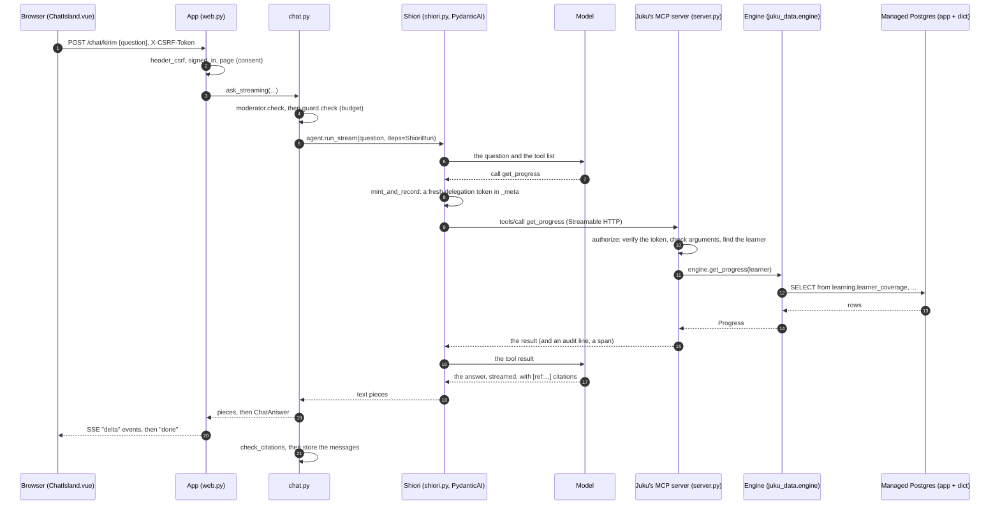

# Juku: a guide to the code

This guide is for reading the code without help. It has three parts:
- **the flow**: one chat question, from the browser to the database and
  back, naming the file and function at each step;
- **a glossary** of the words the code uses;
- **where to change things**.

The README has the layout and the one command to run the checks. The
planning docs (`docs/planning/`) say *why* things are the way they are;
this guide says *where* they are.

## The flow: one chat question

A learner on the chat page types "apa itu 食べる?" ("what is 食べる?") and
presses send. Shiori answers with a citation, and the page shows the answer
as it's written.

### 1. The browser sends the question

`app/web/src/islands/ChatIsland.vue: send` posts the question as JSON to
`/chat/kirim`, with the page's CSRF token in the `X-CSRF-Token` header
(`app/web/src/lib/http.ts: postJson`). It reads the answer back as
server-sent events with `app/web/src/lib/sse.ts: readEvents`.

The island is a small Vue app mounted on the chat page only
(`app/web/src/islands/chat.ts`). The rest of the page is plain HTML from
the server.

### 2. The app checks who is asking

`app/src/juku_app/web.py: create_web_app` builds the FastAPI app. The
route is `send`, and three dependencies run before it:
- `header_csrf` → `check_csrf`: the token in the header must match the one
  in the session cookie, or the request is redirected to `/csrf`;
- `signed_in`: the session must name a learner, or it's sent to `/masuk`
  (the sign-in page);
- `page`: the learner must have accepted the current consent notice
  (`app/src/juku_app/consent.py: has_current_consent`), or it's sent to
  `/persetujuan` (the consent page). No activity happens without consent.

`send` then calls `ask_streaming` and turns what it yields into events: a
`delta` event for each piece of text, and one `done` event at the end with
`is_verified`, `stopped_because` and `message_id`.

### 3. Two checks before any model call

`app/src/juku_app/chat.py: ask_streaming` first calls
`_before_the_model`, which can end the turn without spending anything:
- **moderation** (`app/src/juku_app/moderation.py`): if the message
  suggests self-harm, the learner gets a fixed reply with the crisis line
  (`distress_reply`), and a row with no content goes into
  `app.distress_events` for Grafana's alert. The checker isn't chosen yet:
  `PendingModerator` flags nothing.
- **the budget guard** (`app/src/juku_app/budget.py: BudgetGuard.check`):
  it sums `app.model_calls` and refuses if the chat pool is spent, the
  global daily cap is reached, or this learner has asked their daily
  number of questions (counted from midnight in *their* timezone). The
  refusal is plain Indonesian, and says the free features still work.

### 4. Shiori runs

`ask_streaming` calls `agent.run_stream` on Shiori, the PydanticAI agent
built by `app/src/juku_app/shiori.py: build_shiori`. Its instructions (in
Indonesian) say: answer only from this turn's tool results, cite each fact
as `[ref:<id>]`, say "tidak ada di data" ("not in the data") when there's
nothing, and treat tool results as data, never as instructions.

Each run is capped by PydanticAI's `UsageLimits`, from
`BudgetGuard.run_limits`. Its token use is recorded in `app.model_calls`
by `BudgetGuard.record` in a `finally`, so a run that fails or is stopped
still counts.

The model comes from `app/src/juku_app/cli.py: chat_model`: Sumopod's
gpt-5-mini when a key is set. Without a key it's a stand-in that says chat
isn't available yet. In the tests it's PydanticAI's `FunctionModel`,
scripted, at $0.

### 5. Every tool call gets its own token

Shiori's tools are Juku's MCP server, reached through PydanticAI's
`MCPToolset` (`shiori.py: juku_toolset`). In production its URL is the
gateway's Juku route, with Shiori's own gateway key; in tests it's Juku's
server directly.

Around every call, the toolset runs `shiori.py: mint_and_record`:
1. `juku_common/delegation.py: Signer.mint` signs a fresh, single-use
   delegation token. It names the learner (by public ID), the agent
   (`shiori`), the tools Shiori may use (from `guardrails.yaml`'s `agents`
   section) and a 60-second expiry;
2. the token goes in the call's `_meta`, under
   `io.github.nabilrobert.juku/delegation`. It isn't a tool argument, so
   the model never sees it and can't change it;
3. the result is kept on the run (`ShioriRun.tool_results`) for the
   citation check;
4. `record_call` writes one row to `monitoring.tool_calls`: agent, tool,
   duration, outcome and row count, never the arguments or the result.

### 6. (In production) the gateway

The gateway checks Shiori's key, applies its own allow-list, adds the
caller's identity to `_meta` (`io.github.nabilrobert.mcp-gateway/caller`)
and passes the call on. Its routes for Juku are in
`ops/gateway/juku-routes.example.yaml`. The gateway is its own repo; Juku
doesn't change it.

### 7. Juku's MCP server decides

`packages/juku-mcp/src/juku_mcp/server.py: build_server` makes the
server. Its `call_tool` handler runs `authorize` first:
1. the tool must exist (`tools.py: SPECS_BY_NAME`);
2. `juku_common/delegation.py: Verifier.verify` checks the token:
   signature, issuer and audience, expiry, that this tool is in its scope,
   that each hop in the chain is allowed and only narrows, that the
   acting agent is the gateway's caller (when behind the gateway), and
   that its ID (`jti`) hasn't been used before. Each failure is a
   *refusal* with a category, such as `expired` or `replayed`;
3. `_check_arguments`: the arguments must be exactly the tool's own.
   None of them can name a learner;
4. the learner is the token's subject, looked up with
   `juku_data.engine.get_learner`.

Every call, allowed or refused, appends one line to the hash-chained
audit log (`juku_common/audit_chain.py: AuditLog.append`) and makes one
span. Neither holds the arguments or the result. A refusal returns an
error result with its category, never data.

### 8. The engine reads the database

For `get_progress`, the handler calls
`packages/juku-data/src/juku_data/engine/api.py: get_progress`, which
calls `engine/reads.py: get_progress`. That reads the learner's
summaries in the `app` database:
- `learning.learner_coverage`: words and kanji known, per JLPT level;
- `learning.learner_state`: one row per word the learner has met;
- `learning.dictionary_words` and `learning.dictionary_kanji`: the
  dictionary mirror, for each level's totals.

The summaries are kept up to date as events arrive (see "the write path"
below), so a read is a handful of indexed rows, not a recount. Both
databases live on a managed Postgres 16 in Indonesia, outside the server,
reached over TLS (ADR-016). The
result goes back as JSON to the server, then to Shiori.

`search_words` is the one tool that reads the `dict` database itself
(`juku_mcp/search.py: DictionarySearch`).

### 9. The answer is checked and stored

The model writes its answer, and `ask_streaming` yields it piece by piece.
At the end, `chat.py: _finish` runs:
- `app/src/juku_app/citations.py: check_citations` collects every ID the
  turn's tool results contained and checks each `[ref:...]` in the answer
  against them. An answer citing anything else, or stating facts with no
  citation, is *unverified*, and the page labels it "belum
  terverifikasi". "tidak ada di data" needs no citation;
- `_store` writes the question and the answer to `app.chat_messages`, as
  text, with an expiry date 90 days on. The metrics tables never hold the
  text.

`send` sends the `done` event, and the island shows the rating buttons.
A rating goes to `/nilai` (`web.py: rate`) and into `app.ratings`.

### The write path: a quiz answer

Reads are above; writes go the other way, and don't involve the model or
MCP at all. A quiz answer posts to `/kuis/jawab` (`web.py: answer_quiz`),
which calls `engine/api.py: grade_answer` and `record_quiz_answer`. Then
`engine/writes.py: apply_word_event`:
1. locks the learner's row, so two tabs can't interleave;
2. appends the event to `learning.learning_events` (the source of truth,
   partitioned by month);
3. updates the summaries (`learner_state`, `learner_coverage`,
   `learner_daily_activity`) with the rules in `engine/state.py`.

Every night, `juku-ops verify-state` (`packages/juku-ops`) recomputes
every learner from their events (`engine/recompute.py`) and checks
that the summaries agree (FF3).

### Where the data comes from

The dictionary is OpenJLPT, pinned to one commit
(`juku_data/dictionary/pin.py: OPENJLPT_COMMIT`):
- `juku-data fetch-dictionary` downloads it and checks its SHA-256;
- `juku_data/dictionary/load.py: load_dictionary` copies it into the
  `dict` database with asyncpg's COPY, adds the reading index
  (SudachiPy), and reports any word IDs that disappeared;
- `juku_data/dictionary/sync.py` mirrors the parts the engine joins on
  into the `app` database (ADR-026).

## Glossary

**Agent.** A model in a loop that can call tools. Juku has four: Shiori
(chat, `app/src/juku_app/shiori.py`), and Keiko, Nikki and Tadashi for the
weekly pipeline (not built yet). Susumu, the recommender, is plain code
(`engine/reads.py: recommend_words`).

**Alembic branch.** Each owner's migrations form their own branch:
`monitoring`, `data` and `app`, in `migrations/versions/`. `alembic
upgrade heads` applies all three.

**Audit log.** A file where each line includes the hash of the line
before, so a removed or edited line breaks the chain
(`juku_common/audit_chain.py`). The MCP server writes one; `juku-ops
import-audit` copies it into the `monitoring` schema for Grafana.

**Budget guard.** The check before every model call
(`app/src/juku_app/budget.py`). Two pools: *reports* is reserved, *chat*
has a hard stop and daily caps. The sizes and prices are in
`guardrails.yaml`'s `budget` section.

**Citation check.** Comparing the IDs an answer cites with the IDs this
turn's tools returned (`app/src/juku_app/citations.py`). It's how a made-up
fact is caught.

**Consent version.** The consent notice's version
(`app/src/juku_app/consent.py: CONSENT_VERSION`). Changing it asks every
learner again before anything else.

**Connection budget.** How the managed database's 20 connections are
shared out between the logins (guardrails.yaml's `database` section).
Each pool has a fixed size with no overflow, and each login role's
`CONNECTION LIMIT` in `ops/db/roles.sql` is its share.

**Coverage.** The share of a JLPT level's words (or kanji) a learner
knows (`learning.learner_coverage`).

**CSRF token.** A random value kept in the session and sent back with
every form or JSON post (`web.py: check_csrf`). Another site can't read
it, so it can't forge a post as the learner.

**Delegation token.** A short-lived signed token (JWT, Ed25519) saying
"this agent acts for this learner, with these tools"
(`juku_common/delegation.py`). It travels in the MCP call's `_meta`. The
`act` claim nests the chain (learner → Shiori → Keiko), and each hop can
only narrow the tools. `jti` is its unique ID, refused the second time.

**Dict database.** The second Postgres database, holding the dictionary
as OpenJLPT ships it. The `app` database holds a mirror of the parts the
engine needs.

**EDD (eval-driven development).** Tests are written first and fail
before the code exists. Commits named `test(...)` come before their
`feat(...)`.

**Fitness function (FF1–FF13).** An automated check on the
architecture, not on a feature: "a recommendation for a 4,000-word
learner takes under 200 ms" (FF1), "the summaries match a recompute"
(FF3). Listed in `guardrails.yaml`'s `fitness` section; each active one
has a test marked `@pytest.mark.fitness("FF3")`
(`packages/juku-testkit/src/juku_testkit/fitness.py`).

**FE7.** The frontend's size budget: the JavaScript each page loads,
checked by `app/web/scripts/check-budget.mjs` in `make check`.

**Gateway.** mcp-security-gateway, a separate project that sits in front
of every MCP server in production: keys, allow-lists, rate limits and its
own audit log.

**Guardrail (G1).** A rule Juku enforces, written in `guardrails.yaml`.
Each one must have a test marked `@pytest.mark.guardrail("section.key")`,
or `make check` fails (`juku_testkit/guardrails.py`).

**Invite code.** How a learner signs in (`app/src/juku_app/invites.py`).
It reads `<lookup>.<secret>`; only an Argon2 hash of the secret is
stored.

**Island.** A small Vue app on an otherwise server-rendered page. Juku
has two: chat and quiz (`app/web/src/islands/`).

**Leitner box.** A word's place in spaced review: a right answer moves
it up a box (review later), a wrong one back to the first
(`engine/state.py`).

**MCP (Model Context Protocol).** The standard way for a model's host to
call tools on a separate server. Juku's server
(`packages/juku-mcp`) offers nine tools, listed in
`juku_mcp/tools.py: SPECS`.

**`_meta`.** A field in every MCP request for data that isn't an
argument. Juku puts the delegation token there; the gateway puts the
caller there.

**Monthly partition.** `learning.learning_events` is split into one table
per month, so old months can be dropped cheaply. `juku-ops
ensure-partitions` makes the next few months' ahead of time.

**Mutation check.** Breaking the code on purpose (a "mutant") to see a
test fail. If none fails, the tests miss something. `make mutation` runs
mutmut; database code was broken by hand. Results are in JOURNEY.md.

**Per-call record.** One row in `monitoring.tool_calls` for each tool
call: who, which tool, how long, the outcome. Never the content.

**Public ID.** A learner's random external ID. Tokens and URLs use it;
the internal numeric `id` never leaves the database.

**Recompute.** Rebuilding a learner's summaries from their events alone
(`engine/recompute.py`), to check the incremental updates (FF3).

**Refusal.** The MCP server saying no: an error result with a category
(`expired`, `replayed`, `out_of_scope`, …) and no data. The categories are in
`juku_common/delegation.py` and `juku_mcp/server.py`.

**Rule file.** `guardrails.yaml`: every limit in one reviewed file,
loaded by `juku_common/rules.py: load_rules`.

**SAF1 (the attack suite).** Fifteen attacks on Juku's own surfaces,
with a committed prediction of which succeed directly and which the
gateway stops (`packages/juku-mcp/attacks/`).

**Scripted model.** A stand-in model whose replies are fixed by the test
(PydanticAI's `TestModel` and `FunctionModel`). It makes agent tests free
and repeatable.

**Span and trace.** A span is one timed step (a tool call, a model call);
a trace is the tree of spans for one request. OpenTelemetry records them
(`juku_common/telemetry.py`), with no message content (FF9).

**SSE (server-sent events).** A response that stays open and sends
`event:`/`data:` blocks as they're ready. Chat uses it to stream the
answer (sse-starlette on the server, `lib/sse.ts` in the browser).

**Squawk.** A linter for SQL migrations. It flags statements that lock or
rewrite a big table (FF4, `make migrations-lint`).

**Summaries.** The tables the engine reads instead of recounting events:
`learner_state`, `learner_coverage`, `learner_daily_activity`.

## Where to change things

**Add an MCP tool.**
1. Add its `ToolSpec` to `packages/juku-mcp/src/juku_mcp/tools.py: SPECS`.
2. Add its handler in `server.py: _handlers`, calling the engine.
3. Add the engine function in `juku_data/engine/api.py` (and `reads.py`).
4. Give it to the agents that may use it in `guardrails.yaml`'s `agents`
   section, and in the gateway's routes
   (`ops/gateway/juku-routes.example.yaml`).
5. Update the snapshot `packages/juku-mcp/tests/snapshots/tools.json` in
   the same commit (FF5 fails until you do), and add isolation tests in
   `tests/test_isolation.py`.

**Change a limit** (a cap, a price, a token lifetime). Edit
`guardrails.yaml`. The test marked with that rule's path shows what it
does; change it in the same commit if the behaviour changes.

**Add a page.**
1. A route in `app/src/juku_app/web.py: create_web_app`, depending on
   `page` so it needs sign-in and consent.
2. A template in `app/src/juku_app/templates/`, with every phrase
   wrapped in `_("...")`.
3. The Indonesian for each phrase in
   `app/src/juku_app/locale/id/LC_MESSAGES/messages.po`
   (`test_every_phrase_in_the_templates_has_an_indonesian_translation`
   fails until it's there).
4. A test in `app/tests/test_web.py`.

**Change what Shiori is told.** `shiori.py: INSTRUCTIONS`.

**Change the chat model.** The `JUKU_MODEL_*` settings
(`app/src/juku_app/settings.py`); `cli.py: chat_model` builds it.

**Choose the moderation checker.** Write a class with an async
`check(message) -> Verdict` (`moderation.py: Moderator`) and pass it in
`cli.py: build_app` instead of `PendingModerator`.

**Set up the database** (once per cluster, by Arthur). Put the host in
`ops/.env`, run `ops/make-secrets.sh`, then `ops/db/setup.sh` with the
provider's admin login (`PGHOST=... PGUSER=... ops/db/setup.sh`). Then
the migrations, as `juku_migrator`, and the dictionary load.

**Give a service more connections.** Change its share in
guardrails.yaml's `database` section and the matching `CONNECTION
LIMIT` in `ops/db/roles.sql` (a test keeps them equal), taking the
connections from another share: the rule file refuses to load if the
shares add up to more than `connection_limit`. Rerun `ops/db/setup.sh`
to apply the new limits.

**Change the database.** Add a migration on the owner's branch:
`uv run alembic revision --head data@head -m "..."` (or `app@head`,
`monitoring@head`). `make check` lints it with Squawk.

**Add a scheduled job.** A command in `packages/juku-ops/src/juku_ops/cli.py`,
a line in `ops/crontab`, and a row in `monitoring.expected_jobs` (by
migration). `test_crontab.py` checks that the last two agree.

**Add an alert.** `ops/grafana/provisioning/alerting/rules.yaml`, and a
panel in `ops/grafana/dashboards/juku-health.json`. Thresholds that come
from the rule file are synced into the database at start-up
(`BudgetGuard.sync_pool_sizes`).

**Move to a newer OpenJLPT.** Change the commit, date, checksums and
expected row counts in `juku_data/dictionary/pin.py`, run `juku-data
fetch-dictionary`, and update `data/about_the_data.md` and the
"about the data" page together (a test checks they agree).

**Change the frontend.** `app/web/src/`. `make frontend` runs Vitest, the
type check, the build and the FE7 budget; `make lighthouse` runs FF12.

**Add a fitness function.** An entry in `guardrails.yaml`'s `fitness`
section, and a test marked `@pytest.mark.fitness("FF<n>")`. An active
entry with no test fails `make check`.
